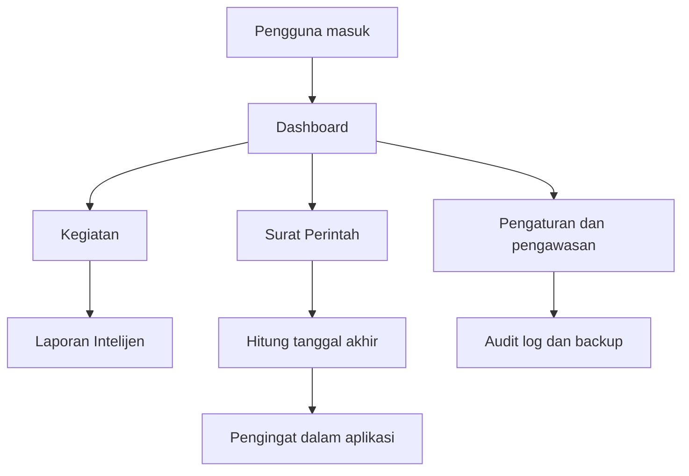

# Panduan penggunaan SIAK Intel

SIAK Intel adalah aplikasi lokal untuk mencatat kegiatan, menyimpan laporan dalam berkas privat, mengelola surat perintah dan pengingat tenggat, serta mencatat jejak audit. Semua pengguna dengan izin melihat data dapat melihat seluruh data aplikasi sesuai keputusan akses saat ini.

Masuk melalui `http://127.0.0.1:8000/admin`. Setelah masuk, buka menu profil di kanan atas untuk mengganti kata sandi dan, bila diperlukan, mengaktifkan MFA dari aplikasi authenticator. Jangan membagikan akun atau kata sandi.

## Cara kerja singkat

1. Administrator menyiapkan akun, role, jenis laporan, jenis surat, aturan pengingat, dan kalender hari libur.
2. Petugas mencatat kegiatan bila diperlukan, kemudian membuat laporan dan mengunggah berkasnya.
3. Berkas laporan disimpan pada penyimpanan privat. Berkas tidak dapat diakses melalui URL publik; unduhan selalu memeriksa izin pengguna.
4. Saat berkas laporan diperbarui, sistem membuat versi baru dan mempertahankan versi lama.
5. Saat surat perintah dibuat, sistem mengambil aturan durasi dari jenis surat dan menyimpan salinannya pada surat itu. Perubahan aturan jenis surat di kemudian hari tidak mengubah tanggal surat yang sudah ada.
6. Scheduler memeriksa tenggat setiap hari. Jika sebuah aturan pengingat jatuh pada hari itu, sistem membuat pengingat untuk setiap pengguna aktif yang berhak melihat surat perintah.
7. Perubahan penting, unduhan laporan, penolakan akses, login, dan proses backup dicatat pada audit log.

## Hak akses

| Role | Fungsi utama |
|---|---|
| Administrator Sistem | Mengelola seluruh aplikasi: akun, role, konfigurasi, laporan, kegiatan, surat perintah, audit log, dan backup. |
| Petugas Laporan | Mengelola kegiatan, kategori, laporan, serta membuat, mengubah, dan menutup surat perintah. |
| Pengguna Baca | Melihat kegiatan, laporan, surat perintah, serta mengunduh berkas laporan yang diizinkan. |

Role adalah kumpulan izin, bukan akun. Satu akun dapat diberi satu atau lebih role, meskipun penggunaan sehari-hari sebaiknya memakai satu role yang sesuai tugasnya. Hanya Administrator Sistem yang dapat mengubah role dan izin.

## Halaman utama

### Dashboard

Dashboard menampilkan ringkasan data yang boleh dilihat pengguna, termasuk laporan menurut jenis, surat perintah yang dekat tenggat, dan laporan terbaru. Halaman ini adalah titik awal untuk memeriksa pekerjaan yang perlu ditindaklanjuti.

### Kegiatan

Halaman **Kegiatan** mencatat aktivitas administratif yang dapat dikaitkan ke laporan. Isi kategori, kode referensi, nama, tanggal, unit administratif, status laporan, serta keterangan. Kegiatan dapat dicari dan difilter menurut kategori atau status.

Gunakan **Kategori Kegiatan** untuk menambah atau memperbarui daftar kategori. Kategori yang masih dipakai data tidak boleh dihapus agar relasi data tetap benar.

### Laporan Intelijen

Halaman **Laporan Intelijen** menyimpan metadata laporan dan berkas privatnya.

Saat membuat laporan, isi nomor laporan, jenis, subjenis bila ada, kegiatan terkait, perihal, nomor referensi, tanggal, status pengiriman, status pemeriksaan, catatan administratif, lalu unggah berkas. Jenis dan subjenis harus aktif dan subjenis harus berasal dari jenis laporan yang dipilih.

Gunakan tombol **Unduh** untuk mengunduh berkas setelah sistem memeriksa izin. Pada halaman detail, riwayat versi menunjukkan berkas lama. Mengunggah berkas baru saat mengubah laporan membuat versi baru dan tidak menimpa versi sebelumnya. Penghapusan laporan bersifat sementara; metadata dapat dipulihkan oleh pengguna yang berwenang, sedangkan berkas fisik tetap disimpan.

**Pengaturan Laporan** berisi:

- **Jenis Laporan** untuk membuat atau mengaktifkan jenis laporan.
- **Subjenis Laporan** untuk mengatur subjenis/kategori di bawah jenis tertentu.

Aktifkan jenis dan subjenis hanya setelah istilah serta alur kantor dikonfirmasi.

### Surat Perintah

Halaman **Surat Perintah** digunakan untuk memasukkan nomor surat, jenis surat, tanggal mulai, durasi, penanggung jawab, dan catatan administratif. Sistem menghitung tanggal akhir berdasarkan konfigurasi jenis surat: hari kalender atau hari kerja, serta apakah tanggal mulai dihitung sebagai hari pertama.

Pada halaman detail surat:

- **Catat perpanjangan** menambah durasi dan wajib memuat referensi persetujuan serta alasan.
- **Tutup surat** meminta alasan penutupan dan menghentikan status aktif surat.
- **Histori Perubahan Surat** memperlihatkan pembuatan, perubahan durasi/tanggal, perpanjangan, dan penutupan.

Pemisahan kewenangan saat ini: Petugas Laporan dapat membuat, mengubah, dan menutup surat. Perpanjangan hanya dapat dilakukan pengguna dengan izin khusus, yang saat ini dimiliki Administrator Sistem.

**Pengaturan Tenggat** berisi:

- **Konfigurasi Jenis Surat** untuk menentukan durasi awal, dasar perhitungan, dan catatan aturan.
- **Aturan Pengingat** untuk menentukan berapa hari kerja sebelum tenggat pengingat dibuat.

**Kalender Hari Libur** menyimpan hari libur yang dikecualikan dari perhitungan hari kerja. Administrator harus mengisinya sesuai kalender resmi yang telah dikonfirmasi.

### Pengingat

Halaman **Pengingat** menampilkan pengingat milik pengguna yang sedang masuk. Pengguna dapat membuka surat terkait atau menandai pengingat sebagai dibaca. Jika tanggal akhir surat berubah, pengingat lama ditandai tidak berlaku dan tidak dihapus dari riwayat.

Pengingat dibuat oleh scheduler, bukan saat halaman dibuka. Pada Windows, Task Scheduler harus menjalankan `artisan schedule:run` secara berkala agar pemeriksaan pengingat harian berjalan.

### Pengguna dan Role

Halaman **Pengguna** dipakai untuk membuat akun, mengganti nama/email, mengaktifkan atau menonaktifkan akses, dan menetapkan role. Kata sandi minimal 12 karakter. Pengguna tidak dapat menonaktifkan atau mengganti role akunnya sendiri dari halaman ini.

Halaman **Peran dan Izin** dipakai untuk mengatur daftar izin tiap role. Perubahan role dapat menaikkan akses pengguna secara langsung, sehingga hanya administrator yang ditunjuk yang boleh mengubahnya. Audit log menyimpan role dan izin sebelum serta sesudah perubahan.

### Audit Log dan Riwayat Backup

**Audit Log** hanya untuk membaca jejak tindakan. Data di sini tidak dapat diubah dari aplikasi.

**Riwayat Backup** menampilkan backup lokal yang pernah dibuat serta hasilnya. Administrator dapat membuat backup dan memeriksa checksum backup yang berhasil. Backup berisi basis data dan berkas privat; simpan pada media yang hak aksesnya dibatasi.

## Alur kerja harian yang disarankan

1. Masuk dan cek Dashboard serta Pengingat.
2. Tambahkan atau perbarui Kegiatan bila ada aktivitas baru.
3. Buat Laporan Intelijen, periksa jenis/subjenis, lalu unggah berkas yang benar.
4. Jika laporan diperbaiki, ubah catatan atau unggah versi berkas baru; jangan membuat catatan duplikat untuk laporan yang sama.
5. Tambahkan Surat Perintah dan cek tanggal akhir hasil perhitungan.
6. Catat perpanjangan hanya sesudah ada referensi persetujuan. Tutup surat yang selesai dan isi alasan.
7. Administrator memeriksa Audit Log, hari libur, pengingat, serta backup secara berkala.

## Hal yang perlu diperhatikan

- Gunakan data latihan sampai instansi menyetujui jenis data, klasifikasi, retensi, dan alur pemeriksaan yang berlaku.
- Status pemeriksaan laporan dan aturan durasi surat adalah pengaturan administratif yang perlu dikonfirmasi kantor.
- Berkas laporan berada di penyimpanan privat. Jangan memindahkan folder berkas ke `public` dan jangan membuat symlink publik.
- Password lama tidak dapat ditampilkan kembali karena disimpan sebagai hash. Reset password melalui Pengguna atau ubah sendiri lewat Profil.
- Secret MFA bergantung pada `APP_KEY`; jangan mengganti `APP_KEY` setelah MFA dipakai tanpa rencana pemulihan yang benar.
